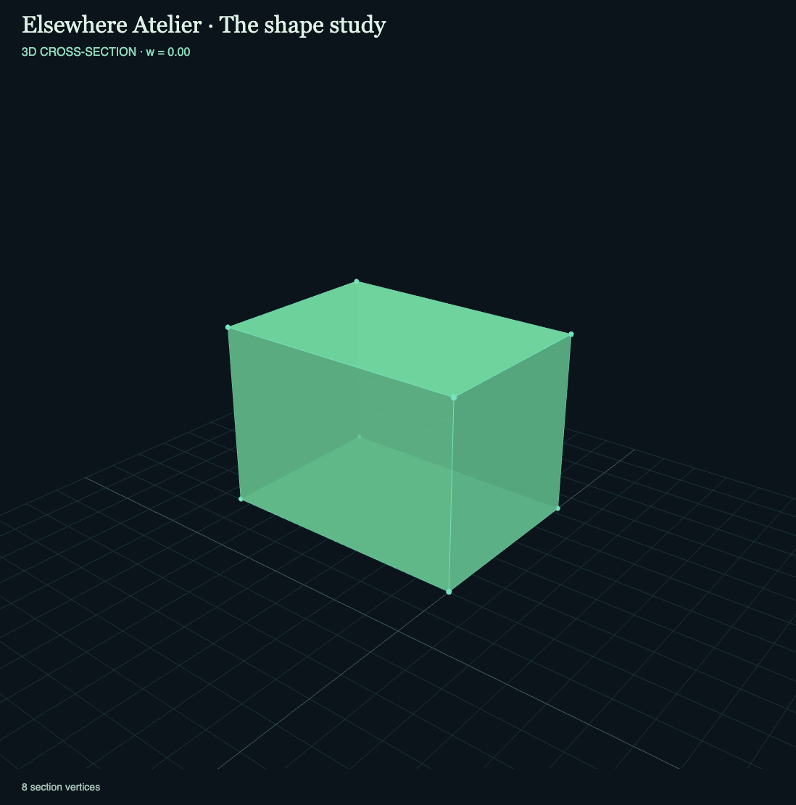

# Elsewhere Atelier
An original browser playground in four spatial dimensions, inspired by [Marc ten Bosch's 4D Toys](https://4dtoys.com/). Built with TypeScript, Three.js and Vite. Three exploratory scenes, no account or paid service.



## Play
`npm ci` then `npm run dev` opens a loopback-only development server at http://127.0.0.1:5192 .

For the session-only detached production preview:
```sh
./scripts/start-play.sh
```
This builds first and records the owned PID in `.play-server.pid` and output in `.play-server.log`. It refuses an occupied port. To restart an existing owned preview, inspect `ps -p "$(cat .play-server.pid)" -o command=`; if it is this checkout's Vite preview, run `kill "$(cat .play-server.pid)"`, then `./scripts/start-play.sh`. No boot/login autostart. Earlier servers are untouched.

## Explore
- Shape study: tesseract, regular 5-cell and 16-cell. Six coordinate-plane rotations, including XW, YW and ZW.
- Sphere orchard: three 4D balls at different w depths.
- Ball room: translating equal-mass balls in a bounded 4D box; press Play or pause to manipulate.

Drag a toy to move it in world x/y at fixed z. Drag empty space to orbit the 3D camera; scroll to zoom. Native x/y/w nudge buttons are keyboard accessible. `[` / `]` move the selected toy in w when focus is outside a form control; Space toggles ball-room motion. Slice sweeping, camera recenter, deterministic scene reset, explicit saved view settings and PNG view export are available.

**Slice** intersects the actual 4D object with w = s. **Projection** drops w from the whole solid, so apparent overlap is not necessarily contact. The rendered 3D camera has perspective in both modes. Tangent point markers are explicitly labeled; very small positive sections retain their true radius. Empty slices are explained in the viewport.

## Checks
`npm run check` runs type checking, mathematical/domain tests and production build. `npm audit --audit-level=moderate` audits all dependencies. GitHub Actions repeats both on every push. See [verification](docs/verification.md), [review](docs/review.md), [scope](docs/spec.md), [glossary](GLOSSARY.md) and [geometry/physics ADR](docs/adr/0001-geometry-and-physics.md).

## Honest boundaries
The ball room uses 4D Euclidean normals, discrete substeps and iterative pair/wall corrections. Gravity play adds downward acceleration and damped sphere contacts; Inertia lab retains equal-mass elastic translation. It is **not a full 4D rigid-body solver**: no angular dynamics, frictional rolling, general polytope collisions, or general continuous collision detection. Constraint correction can alter positions without physical work; dense user-created overlaps may take several steps to settle. Polytope/orchard movement is kinematic. Saving restores view settings, not toy positions/velocities or camera position; reload always pauses motion. Desktop Chrome was physically exercised; responsive emulation was checked, but touch hardware, VR, accelerometers and WebGL context loss were not tested. Serving over localhost is required; double-click file launch is outside scope.

## Tactile fidelity slice (local)
The ball room now defaults to **Gravity play**. Press Play, grab a visible sphere while the others continue falling, push another sphere and release while moving to throw. Recent drag velocity is capped; holding still, cancelling a pointer or leaving the window cannot create a stale throw. The **Inertia lab** option retains elastic zero-gravity translation. Both retain true 4D distances and w slices; projection overlap alone is not contact. The study and orchard remain available.

This is a bounded translational sphere toy, not a general rotating-polytope solver. Gravity acts along visible y; damping/restitution are original gameplay choices. Mode and positions are transient; existing saved view settings remain compatible. See [scope and checks](docs/fidelity-tactile.md) and [completed native acceptance](docs/LOCAL_ACCEPTANCE_2026-10-15.md). No full 4D Toys recreation is claimed.
